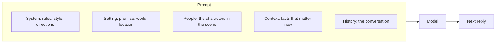
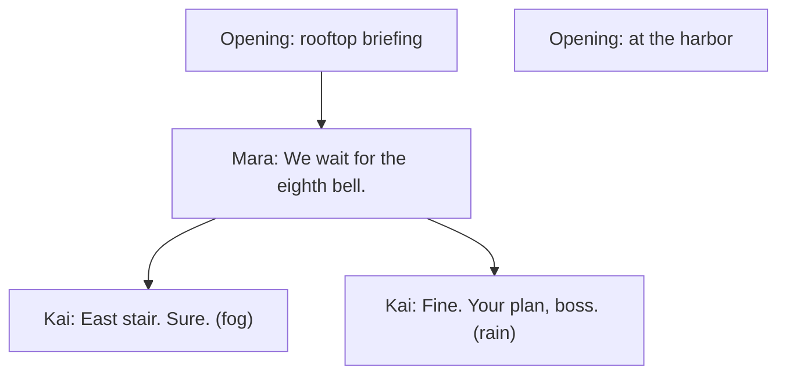
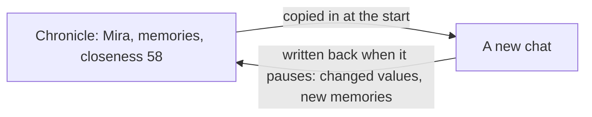

# Troupe beginner's guide

This guide teaches Troupe by building one story: a heist with two thieves, a storm in a lantern, and a clock that runs out at the twelfth bell. It is for people writing their first Troupe files, including people who have written character cards before. No programming is needed.

The guide is informative. [Troupe Format](../spec/format.md) and [Troupe Play](../spec/play.md) are the normative documents; "Format 7.2" means section 7.2 of Troupe Format.

1. [How AI roleplay works](#1-how-ai-roleplay-works)
2. [A first card](#2-a-first-card)
3. [Lore that appears when it matters](#3-lore-that-appears-when-it-matters)
4. [A world and a second character](#4-a-world-and-a-second-character)
5. [Secrets](#5-secrets)
6. [Keeping score](#6-keeping-score)
7. [Making things happen](#7-making-things-happen)
8. [Playing it](#8-playing-it)
9. [Companions who remember](#9-companions-who-remember)
10. [Coming from Character Card V2/V3](#10-coming-from-character-card-v2v3)
11. [Where next](#11-where-next)

## 1. How AI roleplay works

In AI roleplay, a person chats with characters played by a language model: a companion who remembers your day, a crew of thieves, a game master running a dungeon. The person writes as their own character, and the model writes everyone else.

A model has no memory of its own. Each time it replies, the app sends it everything it needs as one long text, the **prompt**: standing instructions, the characters, background facts that matter right now, and the recent conversation. A model reads only a limited amount of text at once, so an app can't send every fact it has. It adds background facts when they become relevant.

So a roleplay file mostly says what goes into the prompt, and when. Troupe arranges the prompt in five parts, called slots:



Most shared characters today are Character Card V2 or V3 files. A card describes one character, its greetings and a lorebook of facts with keywords. That works for a single companion, but people now use cards for much more. Group stories have to pretend to be one character, lorebooks activate differently in every app, stats and inventories are faked with text tricks, every character in a group chat sees every secret, and a companion's memories stay locked in one app. Troupe is designed to fix each of these, and the chapters below show how.

## 2. A first card

This is a complete Troupe file. It holds one character and one way to start a chat with her:

```json
{
  "troupe": "0.11",
  "kind": "bundle",
  "characters": [
    { "id": "elena", "name": "Elena Voss", "description": "A meticulous thief and mapmaker. Calm, exacting, dry humor." }
  ],
  "scenarios": [
    {
      "id": "workshop",
      "openings": [
        { "id": "late", "content": [{ "speaker": "elena", "text": "You're late. Sit down, and don't touch the maps." }] }
      ]
    }
  ]
}
```

- **`troupe`** is the version of the format, and **`kind`** says the file is a **bundle**: a file an author shares, holding characters, worlds and scenarios.
- **`id`** is the short name other parts of the file use for Elena. IDs start with a lowercase letter and use only `a–z`, `0–9` and `_`.
- **`description`** is what the model reads to play her: looks, personality, background, how she talks. Headings such as `## Personality` are fine.
- A **scenario** is what people open. Each of its **openings** is a first message. Give a scenario several and people can **swipe** between them, the way they swipe between versions of a reply.
- **`content`** is a list of parts. A part with a `speaker` is that character's line; a part without one is narration. Put actions in italics, in the speaker's own part: `"*She doesn't look up.* You're late."`

The scenario has no cast, so it gets the default: one seat for the person playing, plus every character in the bundle. The person brings their own character to that seat, called a persona in most apps.

Text can name people with **macros**. `{{user}}` is the player's character and `{{char}}` the character the text belongs to, so an opening can say `"You're late, {{user}}."` and work for every player.

## 3. Lore that appears when it matters

An **entry** is any piece of text the model should read when its conditions hold. Lore, standing rules, style reminders, secrets, goals and memories are all entries, with the same shape wherever they live. Here Elena gets two:

```json
{
  "troupe": "0.11",
  "kind": "bundle",
  "characters": [
    {
      "id": "elena",
      "name": "Elena Voss",
      "description": "A meticulous thief and mapmaker. Calm, exacting, dry humor.",
      "entries": [
        { "id": "style", "position": "system", "text": "Keep Elena's replies short, precise and dry." },
        { "id": "survey", "keys": ["vault", "survey"], "text": "Elena mapped the Duke's vault as a royal surveyor, before she was dismissed." }
      ]
    }
  ],
  "scenarios": [
    { "id": "workshop", "openings": [{ "id": "late", "content": [{ "speaker": "elena", "text": "You're late, {{user}}. Sit down, and don't touch the maps." }] }] }
  ]
}
```

How an entry gets into the prompt:

- **No `keys`:** always on. Rules, secrets and goals are written this way.
- **With `keys`:** it activates when one of the words appears in the last 4 messages, speakers' names included. Keys match whole words and ignore case, so `vault` doesn't match `vaulted`. A key between slashes, such as `/vaults?/`, is a pattern for plurals and partial words.
- **With `when`:** a condition must hold too, such as "only after the tenth bell" (chapter 6).
- **With `pull` and a `title`:** the entry is fetched on demand, by the model asking for it or by the app's search. Large lorebooks use this.

Suppose the player has just written "Is the vault still where you drew it?":

| Entry | In the prompt? | Why |
| --- | --- | --- |
| `style` | yes, in System | It has no keys, so it is always on. |
| `survey` | yes, in Context | `vault` appears in the last 4 messages. |

Four messages later, if nobody has said "vault" or "survey" again, `survey` drops out. Its place in the prompt is set by **`position`**: `"system"` for standing direction, `"context"` (the default) for knowledge, or a number for that many messages from the end of the conversation, where models pay the most attention.

A character's entries count only while the character is in the scene, or while the model is writing for them. Elena's lore leaves with her.

## 4. A world and a second character

A heist needs a city, a target and a crew. A **world** is a setting that scenarios share, with its own locations and entries. Kai is the second thief. The scenario now has a premise, a cast and two openings:

```json
{
  "troupe": "0.11",
  "kind": "bundle",
  "name": "The Lantern Heist",
  "characters": [
    {
      "id": "elena",
      "name": "Elena",
      "description": "A meticulous thief and mapmaker. Calm, exacting, dry humor. Distrusts improvisation.",
      "summary": "A meticulous thief who plans every job down to the bell."
    },
    {
      "id": "kai",
      "name": "Kai",
      "description": "A wiry acrobat in a patched red jacket who talks too much and owes everyone money. Reckless, warm, quick to joke and quicker to run.",
      "summary": "A reckless acrobat with debts and a quick grin."
    }
  ],
  "worlds": [
    {
      "id": "veyra",
      "name": "Port Veyra",
      "description": "A storm-battered harbor city ruled by a Duke whose lantern is said to calm the sea.",
      "locations": [
        { "id": "manor", "name": "The Duke's manor" },
        { "id": "rooftops", "name": "Manor rooftops", "parent": "manor" },
        { "id": "vault", "name": "Lantern vault", "description": "A half-flooded cellar.", "parent": "manor" }
      ],
      "entries": [
        { "id": "storm_lantern", "keys": ["lantern"], "priority": 80, "text": "The lantern holds a captured storm. If its glass cracks, the harbor floods within the hour." },
        { "id": "weather_rain", "group": "weather", "weight": 3, "sticky": 6, "cooldown": 4, "text": "Rain keeps falling, slicking every roof and muffling footsteps." },
        { "id": "weather_fog", "group": "weather", "sticky": 6, "cooldown": 4, "text": "Fog rolls in from the harbor; nobody can see past ten paces." }
      ]
    }
  ],
  "scenarios": [
    {
      "id": "heist",
      "premise": "Port Veyra, the night of the Tide Festival. {{user}} has hired two thieves to steal the Duke's storm lantern before the harbor bells ring twelve.",
      "briefing": "You are the crew's boss. Elena plans; Kai improvises.",
      "cast": [
        { "notes": "The crew's boss, who hired them both." },
        { "character": "elena" },
        { "character": "kai", "notes": "Tonight Kai is jumpy and keeps glancing toward the harbor." }
      ],
      "openings": [
        {
          "id": "rooftop_briefing",
          "title": "Rooftop briefing",
          "set": { "scene.location": "rooftops" },
          "content": [
            { "text": "Rain hammers the slate roofs above the Duke's manor." },
            { "speaker": "elena", "text": "*Elena unrolls a soaked map.* Two guards on the east stair. We go at the eighth bell." },
            { "speaker": "kai", "text": "Or we go now, while they're drunk. *He grins at {{user}}.* Your call, boss." }
          ]
        },
        { "id": "harbor", "title": "At the harbor", "set": { "scene.location": "manor" } }
      ]
    }
  ]
}
```

- **The cast** lists who takes part. `{}` is a **seat** for a person; `notes` add context for this story only. A cast with two seats is a two-player story.
- **`premise`** is the situation, sent to the model. **`briefing`** is for the players and is never sent to the model.
- **`set`** in an opening gives starting values, here the location. The model learns where the scene is, and conditions can test it (chapter 6).
- **An opening without `content`**, like `harbor`, lets the model write the first message. A list of these works as a menu of starting points.
- **Presence.** The players' characters and the characters who speak in an opening start present, or the whole cast for an opening without `content`. Everyone else is offstage. An offstage character's description stays out of the prompt, and when someone mentions them, the model gets only their `summary`.

The weather entries show the timing and competition options:

- **`group`:** at most one entry of a group is used. Neither weather entry has keys, so both always qualify, and a weighted roll picks one: rain 3 to fog 1.
- **`sticky: 6`:** once chosen, the weather stays for 6 rounds. A **round** is one player message and the replies to it, so a story paces the same in a one-on-one chat and a busy group.
- **`cooldown: 4`:** after that, it rests for 4 rounds, so fog gets its turn.
- **`priority`** (0 to 100, default 50) decides what is dropped first when the prompt runs out of room. The lantern's danger, at 80, outlasts ordinary lore.

## 5. Secrets

Stories depend on people not knowing things. Elena still has the surveyor's master key to the vault and hasn't told anyone. Kai has taken the Duke's money to lead the crew into a trap. Each secret is an entry with **`knownBy`**:

```json
{ "id": "master_key", "knownBy": ["elena"], "text": "Elena still has the surveyor's master key to the Duke's vault, and hasn't told anyone." }
```

```json
{ "id": "deal", "knownBy": ["kai"], "text": "The Duke paid Kai to lead the crew into a trap at the vault door. He is starting to regret it." }
```

The first goes in Elena's `entries`, the second in Kai's. Without `knownBy`, a character's entries reach every character present, so a secret always needs it. An instruction for one character's turns works the same way: Kai's way of talking is an entry known only by Kai.

```json
{ "id": "voice", "knownBy": ["kai"], "position": 4, "text": "{{char}} calls people 'boss' and talks in quick, joking bursts." }
```

By default, the scenario's `mode` is `characters`: the model writes each character's turn separately, and each turn's prompt holds only what that character knows. The conversation follows the **witness rule**: a line is known by its speaker and by everyone present when it is said. A character who has left the scene doesn't hear what is said next. A part of a message can also carry `knownBy`, for a whisper or a private thought:

| Line in the chat | Elena knows it | Kai knows it |
| --- | --- | --- |
| Mara: "Kai, you take the east stair." | yes | yes |
| Kai, thinking: *If the Duke's men are early, this ends badly.* (`knownBy: ["kai"]`) | no | yes |
| Elena to Mara, after Kai has left: "Watch him." | yes | no |

In `narrator` mode, one voice writes the whole scene and sees everything. A **narrator** can also take turns in `characters` mode; an entry with `knownBy: ["narrator"]` reaches only the narrator, which is how a mystery's clues stay hidden from its suspects. Knowledge limits what the model sees, never what people can read in the file.

## 6. Keeping score

The heist runs on a clock: the harbor bells. A **variable** holds state like this, and every variable is declared, so every app knows what its values mean and who may change them. Add these to the scenario's `variables`:

```json
{ "id": "bell", "type": "int", "initial": 6, "min": 6, "max": 12, "by": ["model"], "maxStep": 2, "oneWay": true,
  "description": "The last harbor bell that has rung tonight. Goes up by one when about an hour of story time passes." }
```

```json
{ "id": "trust", "type": "number", "of": "characters", "initial": { "*": 0.5, "elena": 0.7, "kai": 0.4 }, "min": 0, "max": 1,
  "by": ["model"], "maxStep": 0.2, "spoiler": true,
  "description": "How much this character trusts {{user}}, from 0 to 1. Rises when promises are kept; falls on lies and reckless orders." }
```

```json
{ "id": "approach", "type": "enum", "values": ["quiet", "loud"], "labels": { "quiet": "Slip in unseen", "loud": "Make a scene and grab it" },
  "ask": "How do you want to play this job?", "description": "How {{user}} wants the job done." }
```

- **`type`** is `bool`, `int`, `number`, `string`, `enum` (one of `values`) or `set` (a list of distinct strings, such as an inventory).
- **`description`** is written for authors and the model alike. The model reads it as its instructions when it updates the value.
- **`by: ["model"]`** lets the **tracker** change the value. The tracker is a model call, often cheaper than the story model, that reads the latest messages and reports what changed. Without `by`, only openings, events (chapter 7) and answers to `ask` change a variable.
- **`min`, `max`, `maxStep` and `oneWay`** are guardrails: the bell stays between 6 and 12, moves at most 2 at a time, and never goes back.
- **`of: "characters"`** keeps one value per character, read as `state.trust.kai`.
- **`ask`** puts a question to the player when the chat starts; `labels` name the choices.
- **`spoiler`** hides the value from players' screens until the story ends.

The model doesn't see variables on its own. You choose the wording, and who knows it, with an entry:

```json
{ "id": "clock", "text": "The last bell to ring was the {{state.bell}}th. The plan: {{state.approach}}." }
```

`approach` renders by its label, so the model reads "The plan: Slip in unseen." An entry placed `"tracker"` guides the tracker alone: `{"id": "bells", "position": "tracker", "text": "A bell rings about once an hour of story time."}`.

A character can carry its own variables into any story. Kai declares `nerve`, an `int` from 0 to 3, in his own `variables`, and his own entries read it as `own.nerve`:

```json
{ "id": "rattled", "knownBy": ["kai"], "when": "own.nerve >= 2", "text": "{{char}} is rattled: he jokes too fast and keeps looking for exits." }
```

**Conditions** such as that `when` are short formulas in CEL, a small and safe expression language:

| Condition | True when |
| --- | --- |
| `state.bell >= 10` | the tenth bell or later has rung |
| `scene.location == 'vault'` | the scene is in the vault (strings use single quotes) |
| `state.trust.kai >= 0.8 && hour >= 0 && hour < 6` | Kai trusts the player and it is before 6 a.m. where they are |
| `opening == 'harbor' && turn == 0` | the chat started at the harbor and the player hasn't written yet |
| `hit('glass') && !hit('guard')` | in an entry: "glass" was mentioned and "guard" wasn't |

Some things are hard to test with a formula, like "Elena has told the crew about the key". Make that a `bool` variable with `by: ["model"]` and `oneWay`, with that sentence as its description. The tracker sets it when it happens, and from then on it is a recorded fact.

## 7. Making things happen

An **event** is a story beat written as a rule: when a condition holds, change values, add narration, direct the next reply, or end the story. Add these to the scenario's `events`:

```json
{ "id": "twelfth_bell", "when": "state.bell >= 12", "once": true, "end": true,
  "message": [{ "text": "The twelfth bell tolls across the harbor. Far below, the gates grind shut." }] }
```

```json
{ "id": "patrol", "on": "player", "when": "scene.location == 'rooftops' && turn > 2", "chance": 0.3, "cooldown": 3,
  "outcomes": [
    { "weight": 3, "direct": "A guard patrol passes below. Nobody spots the crew, but it is close." },
    { "weight": 1, "direct": "A guard looks up and sees a shadow move. The crew must hide until the next bell.", "compute": { "bell": "state.bell + 1" } }
  ] }
```

- **`once`** fires at most once; **`end`** marks the story finished; **`message`** adds narration after the message that triggered it.
- **`on: "player"`** runs the event after a player's message, before anyone replies, so its **`direct`** can tell the next reply what happens. Directions reach the model once, then expire.
- **`chance`** is a probability from 0 to 1, and **`cooldown`** keeps the patrol away for 3 rounds after it fires.
- **`outcomes`** pick one weighted alternative each time the event fires: three times in four the patrol passes, once in four it costs the crew an hour.
- **`set` takes plain values and `compute` takes formulas.** Write `"set": {"bell": 11}` but `"compute": {"bell": "state.bell + 1"}`.

A dice check works the same way. The tracker notes what the player is attempting, and an event rolls for it before the reply:

```json
{ "id": "pick_lock", "on": "player", "when": "state.attempt == 'lock'",
  "set": { "attempt": "none" },
  "compute": { "picked": "roll(20) >= 12" },
  "direct": "The lock {{state.picked}}. Narrate it." }
```

Here `attempt` is an `enum` with the values `none` and `lock` that the model may set, and `picked` is a `bool` labeled "opens" and "holds", so the direction reads "The lock opens." The app rolls the die and records the result, so the model can't change it. This needs an app that runs the tracker after player messages.

The full story, with its secrets, variables and events in place, is [Format Appendix B.2](../spec/format.md#b2-a-story-the-lantern-heist), also in [`examples/lantern-heist.troupe.json`](../examples/lantern-heist.troupe.json).

## 8. Playing it

Playing never changes the bundle. The chat is saved as a **session**: a header line naming the scenario, then one message per line. Messages form a tree. Each opening tried is a root, swipes are siblings, and going back to an earlier message to try something else starts a **branch**:



Every outcome is written into the message where it happened: which entries activated, which values changed and who changed them, which events fired. Branches never share state: time lost on one branch is still there to spend on the other. Random choices, such as the weather, come from the session's seed and the message's ID, so any app gets the same roll, and asking for another version of a reply rolls again. That is why a chat saved by one app continues exactly in another. [Format Appendix B.3](../spec/format.md#b3-session) shows this chat as a file.

The player's character usually lives in the session, not the bundle. A session can also carry its own version of a bundle character, which replaces it for that chat. Text that names other characters with `{{@kai}}` instead of writing "Kai" keeps working after such a recast.

The people playing can set **limits**: `lines`, things never to show, and `veils`, things that may happen only offscreen. Apps apply them to every generation and never drop them to save room.

## 9. Companions who remember

A companion needs only a character and a small scenario, like the first card in chapter 2. What makes a companion feel real is memory, and Troupe keeps memory in a **chronicle**: a file that carries one character's current definition, memories and relationship from one chat to the next, and from one app to another.

Mark what should be kept with `carry`. A variable for closeness goes in the character's own `variables`:

```json
{ "id": "closeness", "type": "int", "min": 0, "max": 100, "by": ["model"], "carry": true,
  "description": "How close {{char}} feels to {{user}}." }
```

During a chat, the tracker can add memories as entries on a message, with `carry` so they are kept and `pull` with a `title` so thousands of them don't crowd every prompt:

```json
{ "id": "lake", "title": "The promise about the lake", "pull": true, "carry": true, "knownBy": ["mira"],
  "text": "Mira promised Mara they would see the frozen lake on Thessa in spring." }
```



The chat never needs the chronicle file to replay: everything it uses is copied in when it starts. Apps should let people read, edit and delete every memory. A long friendship can run as many short chats with one chronicle, instead of one endless chat. [Format Appendix B.4](../spec/format.md#b4-chronicle) shows Mira's chronicle.

## 10. Coming from Character Card V2/V3

A V2/V3 card becomes a bundle with one character and a scenario: greetings become swipeable openings, the scenario text becomes the `premise`, the system prompt and post-history instructions become entries known only by the character, and the lorebook becomes entries, with secondary keys written as `when` with `hit()`. A chat file becomes a session, with swipes as siblings. [Character Card V2/V3 and Troupe](character-cards.md) maps every field, in both directions.

## 11. Where next

- [The authoring guide](authoring.md) has patterns for goals and arcs, relationships, clocks, inventories, mysteries, whereabouts and group chats.
- [The authoring brief](authoring-brief.md) is one page to give an LLM that writes Troupe files.
- [Troupe Format](../spec/format.md) lists every field. Part I is all an author needs.
- [`examples/`](../examples/) holds the spec's examples as files, and [`schemas/bundle.schema.json`](../schemas/bundle.schema.json) lets editors check a bundle as you write it.

Files hold text and data, never scripts or HTML, so they are safe to share. Text is Markdown, and anything a player or the model writes stays literal: macros resolve only in text an author wrote.
