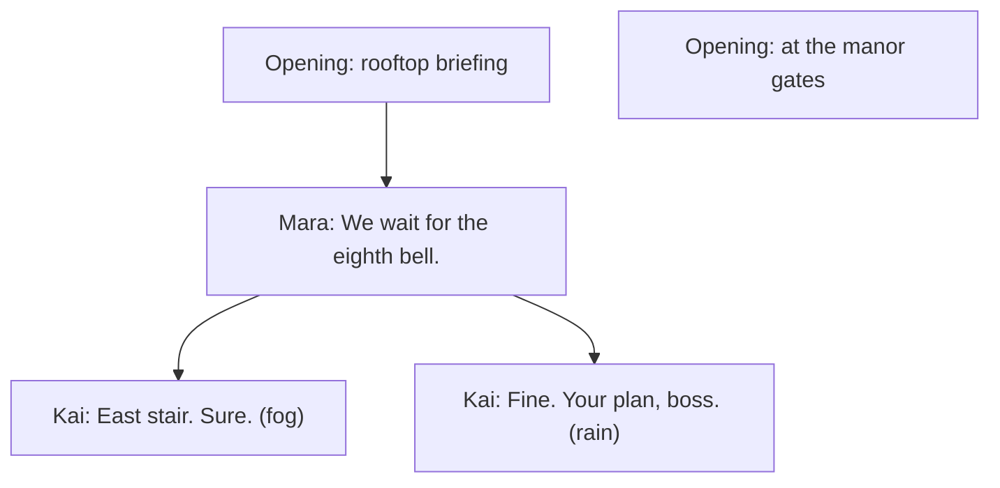

# Troupe beginner's guide

This guide teaches Troupe by building one story: a heist with two thieves, a storm in a lantern, and a clock that runs out at the twelfth bell. It is for people writing their first Troupe files, including people who have written character cards before. No programming is needed.

The guide is informative. [Troupe Format](../spec/format.md) is the normative document; "Format 7.2" means its section 7.2.

1. [How AI roleplay works](#1-how-ai-roleplay-works)
2. [A first card](#2-a-first-card)
3. [Lore that appears when it matters](#3-lore-that-appears-when-it-matters)
4. [A world and a second character](#4-a-world-and-a-second-character)
5. [Secrets](#5-secrets)
6. [Keeping score](#6-keeping-score)
7. [Making things happen](#7-making-things-happen)
8. [Sessions](#8-sessions)
9. [Companions who remember](#9-companions-who-remember)
10. [Coming from Character Card V2/V3](#10-coming-from-character-card-v2v3)
11. [Where next](#11-where-next)

## 1. How AI roleplay works

In AI roleplay, a person chats with characters played by a language model: a companion who remembers your day, a crew of thieves, a game master running a dungeon. The person writes as their own character, and the model writes everyone else.

A model has no memory of its own. Each time it replies, it reads what it needs: standing instructions, the characters, background facts that matter right now, and the recent conversation. It reads only a limited amount of text at once, so background facts come in when they become relevant.

So a roleplay file mostly says what the model should read, and when. A Troupe file declares it; how each app puts it in front of a model is up to the app.

Most shared characters today are Character Card V2 or V3 files. A card describes one character, its greetings and a lorebook of facts with keywords. That works for a single companion, but people now use cards for much more. Group stories have to pretend to be one character, stats and inventories are faked with text tricks, and every character in a group chat sees every secret. Troupe is designed to fix each of these, and the chapters below show how.

## 2. A first card

This is a complete Troupe file. It holds one character and one way to start a chat with her:

```json
{
  "troupe": "0.14",
  "kind": "bundle",
  "characters": [
    { "id": "elena", "name": "Elena Voss", "description": "A meticulous thief and mapmaker. Calm, exacting, dry humor." }
  ],
  "scenarios": [
    {
      "id": "workshop",
      "openings": [
        { "id": "late", "content": [{ "speaker": "elena", "text": "You're late. Sit down, and don't touch the maps." }] }
      ]
    }
  ]
}
```

- **`troupe`** is the version of the format, and **`kind`** says the file is a **bundle**: a file an author shares, holding characters, worlds and scenarios.
- **`id`** is the short name other parts of the file use for Elena. IDs start with a lowercase letter and use only `a–z`, `0–9` and `_`.
- **`description`** is what the model reads to play her: looks, personality, background, how she talks. Headings such as `## Personality` are fine.
- A **scenario** is what people open. Each of its **openings** is a first message. Give a scenario several, and each is an alternative start.
- **`content`** is a list of parts. A part with a `speaker` is that character's line; a part without one is narration. Put actions in italics, in the speaker's own part: `"*She doesn't look up.* You're late."`

The scenario has no cast, so it gets the default: one seat for the person playing, plus every character in the bundle. The person brings their own character to that seat, called a persona in most apps.

Text can name people with **macros**. `{{user}}` is the player's character and `{{char}}` the character the text belongs to, so an opening can say `"You're late, {{user}}."` and work for every player.

## 3. Lore that appears when it matters

An **entry** is any piece of text the model should read when its conditions hold. Lore, standing rules, style reminders, secrets, goals and memories are all entries, with the same shape wherever they live. Here Elena gets two:

```json
{
  "troupe": "0.14",
  "kind": "bundle",
  "characters": [
    {
      "id": "elena",
      "name": "Elena Voss",
      "description": "A meticulous thief and mapmaker. Calm, exacting, dry humor.",
      "entries": [
        { "id": "style", "position": "system", "text": "Keep Elena's replies short, precise and dry." },
        { "id": "survey", "keys": ["vault", "survey"], "text": "Elena mapped the Duke's vault as a royal surveyor, before she was dismissed." }
      ]
    }
  ],
  "scenarios": [
    { "id": "workshop", "openings": [{ "id": "late", "content": [{ "speaker": "elena", "text": "You're late, {{user}}. Sit down, and don't touch the maps." }] }] }
  ]
}
```

When an entry is active:

- **No `keys`:** always on. Rules, secrets and goals are written this way.
- **With `keys`:** it activates when one of the words appears in the last 4 messages, speakers' names included. Keys match whole words and ignore case, so `vault` doesn't match `vaulted`. A key written `/pattern/flags`, such as `/vaults?/i`, is a pattern for plurals and partial words; it ignores case only with the flag `i`.
- **With `when`:** a condition must hold too, such as "only after the tenth bell" (chapter 6).
- **With `pull` and a `title`:** the entry is retrieved on demand, when it becomes relevant. Large lorebooks use this.

Suppose the player has just written "Is the vault still where you drew it?":

| Entry | Active? | Why |
| --- | --- | --- |
| `style` | yes | It has no keys, so it is always on. |
| `survey` | yes | `vault` appears in the last 4 messages. |

Four messages later, if nobody has said "vault" or "survey" again, `survey` is no longer active. **`position`** says what kind of text an entry is: `"system"` for standing direction or `"context"` (the default) for knowledge. **`depth`** instead places an entry inside the conversation, that many messages from its end.

A character's entries count only while the character is in the scene, or speaking. Elena's lore leaves with her.

## 4. A world and a second character

A heist needs a city, a target and a crew. A **world** is a setting that scenarios share, with its own locations and entries. Kai is the second thief. The scenario now has a premise, a cast and two openings:

```json
{
  "troupe": "0.14",
  "kind": "bundle",
  "name": "The Lantern Heist",
  "characters": [
    {
      "id": "elena",
      "name": "Elena",
      "description": "A meticulous thief and mapmaker. Calm, exacting, dry humor. Distrusts improvisation.",
      "summary": "A meticulous thief who plans every job down to the bell."
    },
    {
      "id": "kai",
      "name": "Kai",
      "description": "A wiry acrobat in a patched red jacket who talks too much and owes everyone money. Reckless, warm, quick to joke and quicker to run.",
      "summary": "A reckless acrobat with debts and a quick grin."
    }
  ],
  "worlds": [
    {
      "id": "veyra",
      "name": "Port Veyra",
      "description": "A storm-battered harbor city ruled by a Duke whose lantern is said to calm the sea.",
      "locations": [
        { "id": "manor", "name": "The Duke's manor" },
        { "id": "rooftops", "name": "Manor rooftops", "parent": "manor" },
        { "id": "vault", "name": "Lantern vault", "description": "A half-flooded cellar.", "parent": "manor" }
      ],
      "entries": [
        { "id": "storm_lantern", "keys": ["lantern"], "priority": 80, "text": "The lantern holds a captured storm. If its glass cracks, the harbor floods within the hour." },
        { "id": "weather_rain", "group": "weather", "weight": 3, "sticky": 6, "cooldown": 4, "text": "Rain keeps falling, slicking every roof and muffling footsteps." },
        { "id": "weather_fog", "group": "weather", "sticky": 6, "cooldown": 4, "text": "Fog rolls in from the harbor; nobody can see past ten paces." }
      ]
    }
  ],
  "scenarios": [
    {
      "id": "heist",
      "premise": "Port Veyra, the night of the Tide Festival. {{user}} has hired two thieves to steal the Duke's storm lantern before the harbor bells ring twelve.",
      "briefing": "You are the crew's boss. Elena plans; Kai improvises.",
      "cast": [
        { "notes": "The crew's boss, who hired them both." },
        { "character": "elena" },
        { "character": "kai", "notes": "Tonight Kai is jumpy and keeps glancing toward the harbor." }
      ],
      "openings": [
        {
          "id": "rooftop_briefing",
          "title": "Rooftop briefing",
          "set": { "scene.location": "rooftops" },
          "content": [
            { "text": "Rain hammers the slate roofs above the Duke's manor." },
            { "speaker": "elena", "text": "*Elena unrolls a soaked map.* Two guards on the east stair. We go at the eighth bell." },
            { "speaker": "kai", "text": "Or we go now, while they're drunk. *He grins at {{user}}.* Your call, boss." }
          ]
        },
        { "id": "gates", "title": "At the manor gates", "set": { "scene.location": "manor" } }
      ]
    }
  ]
}
```

- **The cast** lists who takes part. `{}` is a **seat** for a person; `notes` add context for this story only. A cast with two seats has room for two players.
- **`premise`** is the situation. **`briefing`** is for the players, not the model.
- **`set`** in an opening gives starting values, here the location. The location is state: text can name it, and conditions can test it (chapter 6).
- **An opening without `content`**, like `gates`, lets the model write the first message. A list of these works as a menu of starting points.
- **Presence.** Who is present is state too. The whole cast starts present, and an opening's `set` can list `scene.present` instead. Everyone else is offstage, where a character's short `summary` stands for them.

The weather entries show the timing and competition options:

- **`group`:** at most one entry of a group is active. Neither weather entry has keys, so both always qualify, and one is chosen by `weight`: rain three times as often as fog.
- **`sticky: 6`:** once chosen, the weather stays for 6 rounds. A **round** is one player message and the replies to it, so a story paces the same in a one-on-one chat and a busy group.
- **`cooldown: 4`:** after that, it rests for 4 rounds, so fog gets its turn.
- **`priority`** (0 to 100, default 50) is importance: when not everything fits, the lowest priority is left out first. The lantern's danger, at 80, outlasts ordinary lore.

## 5. Secrets

Stories depend on people not knowing things. Elena still has the surveyor's master key to the vault and hasn't told anyone. Kai has taken the Duke's money to lead the crew into a trap. Each secret is an entry with **`knownBy`**:

```json
{ "id": "master_key", "knownBy": ["elena"], "text": "Elena still has the surveyor's master key to the Duke's vault, and hasn't told anyone." }
```

```json
{ "id": "deal", "knownBy": ["kai"], "text": "The Duke paid Kai to lead the crew into a trap at the vault door. He is starting to regret it." }
```

The first goes in Elena's `entries`, the second in Kai's. Without `knownBy`, everyone knows a character's entries, so a secret always needs it. An instruction for one character's turns works the same way: Kai's way of talking is an entry known only by Kai.

```json
{ "id": "voice", "knownBy": ["kai"], "depth": 4, "text": "{{char}} calls people 'boss' and talks in quick, joking bursts." }
```

By default, the scenario's `mode` is `characters`: each character's turns are written for that character alone, from what it knows. The conversation follows the **witness rule**: a line is known by its speaker and by everyone present when it is said. A character who has left the scene doesn't hear what is said next. A part of a message can also carry `knownBy`, for a whisper or a private thought:

| Line in the chat | Elena knows it | Kai knows it |
| --- | --- | --- |
| Mara: "Kai, you take the east stair." | yes | yes |
| Kai, thinking: *If the Duke's men are early, this ends badly.* (`knownBy: ["kai"]`) | no | yes |
| Elena to Mara, after Kai has left: "Watch him." | yes | no |

In `narrator` mode, the narrator writes the whole scene and knows everything but hidden messages. A **narrator** can also take turns in `characters` mode; an entry with `knownBy: ["narrator"]` is known only by the narrator, which is how a mystery's clues stay hidden from its suspects. Knowledge is about characters, never about what people can read in the file.

## 6. Keeping score

The heist runs on a clock: the harbor bells. A **variable** holds state like this, and every variable is declared, so every app knows what its values mean and who may change them. Add these to the scenario's `variables`:

```json
{ "id": "bell", "type": "int", "initial": 6, "min": 6, "max": 12, "by": ["model"], "maxStep": 2, "oneWay": true,
  "description": "The last harbor bell that has rung tonight. Goes up by one when about an hour of story time passes." }
```

```json
{ "id": "trust", "type": "int", "of": "cast", "initial": { "*": 50, "elena": 70, "kai": 40 }, "min": 0, "max": 100,
  "by": ["model"], "maxStep": 20, "spoiler": true,
  "description": "How much this character trusts {{user}}, from 0 to 100. Rises when promises are kept; falls on lies and reckless orders." }
```

```json
{ "id": "approach", "type": "enum", "values": ["quiet", "loud"], "labels": { "quiet": "Slip in unseen", "loud": "Make a scene and grab it" },
  "by": ["player"], "description": "How {{user}} wants the job done." }
```

- **`type`** is `bool`, `int`, `string`, `enum` (one of `values`) or `set` (a list of distinct strings, such as an inventory). Numbers are whole numbers, so trust runs from 0 to 100.
- **`description`** is written for authors and the model alike: what the value means and what moves it.
- **`by`** says who changes the value: `["model"]` lets a model change it as the story goes, and `["player"]` leaves it to the people playing, like the plan for the job. Without `by`, only an opening sets it.
- **`min` and `max`** keep the bell between 6 and 12. **`maxStep`** and **`oneWay`** tell a model that it moves at most 2 at a time and never goes back.
- **`of: "cast"`** keeps one value per character in the cast, read as `state.trust.kai`. `initial` gives Elena and Kai their own starting values, and `*` everyone else's.
- **`labels`** name the values for people.
- **`spoiler`** marks the value and its changes as spoilers for the players.

A value is written by the same name it is read by. An opening that starts late in the night sets `"set": { "scene.location": "vault", "state.bell": 11 }`, and a recorded change to Kai's trust is `"state.trust.kai": 60`.

To put a value in front of the characters, write it into an entry. You choose the wording, and who knows it:

```json
{ "id": "clock", "text": "The last bell to ring was the {{state.bell}}th. The plan: {{state.approach}}." }
```

`approach` renders by its label, so the entry reads "The plan: Slip in unseen."

A character can carry its own variables into any story. Kai declares `nerve`, an `int` from 0 to 3, in his own `variables`, and his own entries read it as `own.nerve`:

```json
{ "id": "rattled", "knownBy": ["kai"], "when": "own.nerve >= 2", "text": "{{char}} is rattled: he jokes too fast and keeps looking for exits." }
```

**Conditions** such as that `when` are short formulas in CEL, a small and safe expression language:

| Condition | True when |
| --- | --- |
| `state.bell >= 10` | the tenth bell or later has rung |
| `scene.location == 'vault'` | the scene is in the vault (strings use single quotes) |
| `state.trust.kai >= 80 && hour >= 0 && hour < 6` | Kai trusts the player and it is before 6 a.m. where they are |
| `opening == 'gates' && turn == 0` | the chat started at the manor gates and the player hasn't written yet |
| `hit('glass') && !hit('guard')` | in an entry: "glass" was mentioned and "guard" wasn't |

## 7. Making things happen

A Troupe file holds no rules that run. The story moves when its state changes, and entries react to the state.

A model changes a variable with `by: ["model"]` when its description says so: the bell goes up as story time passes, and trust rises and falls with what the player does. Some things are hard to test with a formula, like "Kai has confessed the Duke's deal". Make that a `bool` variable with `by: ["model"]` and `oneWay`, with that sentence as its description:

```json
{ "id": "kai_confessed", "type": "bool", "oneWay": true, "by": ["model"],
  "description": "Kai has confessed the Duke's deal to {{user}}." }
```

A model sets it when it happens, and from then on it is a recorded fact. Entries with `when` turn such facts into story. Add these to the scenario's `entries`:

```json
{ "id": "twelfth", "position": "system", "when": "state.bell >= 12", "text": "The twelfth bell has rung and the harbor gates are shut. Bring the story to its end." }
```

```json
{ "id": "patrol", "when": "scene.location == 'rooftops'", "chance": 30, "text": "A guard patrol passes below the rooftops, close enough to hear." }
```

And this to Elena's:

```json
{ "id": "betrayed", "knownBy": ["elena"], "when": "state.kai_confessed", "text": "Elena knows Kai meant to lead the crew into the Duke's trap. She is furious with him." }
```

- **`twelfth`** is direction: once the twelfth bell rings, it tells the model to end the story.
- **`chance`** is a percentage: while the crew is on the rooftops, the patrol comes up 30 times in 100, so it passes now and then.
- **`betrayed`** changes how Elena plays from the moment Kai confesses.

The full story, with its secrets, variables and entries in place, is [Format Appendix B.2](../spec/format.md#b2-a-story-the-lantern-heist), also in [`examples/lantern-heist/bundle.json`](../examples/lantern-heist/bundle.json); its second opening, `caught`, is written out in place of `gates`.

## 8. Sessions

Playing never changes the bundle. The chat is saved as a **session**: a header line naming the scenario, then one message per line. Messages form a tree. Each opening tried is a root, alternative replies are siblings, and going back to an earlier message to try something else starts a **branch**:



Every change is written into the message where it happened: which values changed and who changed them, and which entries activated. Branches never share state: time lost on one branch is still there to spend on the other. Because every change is recorded, a saved chat reopens with the same history and state, without replaying anything. [Format Appendix B.3](../spec/format.md#b3-session) shows the rooftop branch of this chat as a file.

The player's character usually lives in the session, not the bundle, and so does anyone new who joins during the chat. What players and models write is stored as written, so a `{{user}}` typed in the chat stays as typed.

The people playing can set **limits**: `lines`, things never to show, and `veils`, things that may happen only offscreen. They hold for the whole chat.

## 9. Companions who remember

A companion needs only a character and a small scenario, like the first card in chapter 2. What makes a companion feel real is memory.

A variable for closeness goes in the character's own `variables`, so it travels with her into any story:

```json
{ "id": "closeness", "type": "int", "min": 0, "max": 100, "by": ["model"],
  "description": "How close {{char}} feels to {{user}}." }
```

Her entries can react to it, such as `"when": "own.closeness >= 60"` for an entry in which she teases the player gently. During a chat, memories are added as entries on a message, with `pull` and a `title` so each is retrieved only when it matters:

```json
{ "id": "harbor_wall", "title": "The promise about the harbor wall", "pull": true, "knownBy": ["elena"],
  "text": "Elena promised Mara they would walk the harbor wall together on the first dry night." }
```

A memory added on a message holds from there on, on that branch only, so a reply that is swiped away takes its memories with it.

## 10. Coming from Character Card V2/V3

A V2/V3 card becomes a bundle with one character and a scenario: greetings become alternative openings, the scenario text becomes the `premise`, the system prompt and post-history instructions become entries known only by the character, and the lorebook becomes entries, with secondary keys written as `when` with `hit()`. A chat file becomes a session, with alternative replies as siblings. [Character Card V2/V3 and Troupe](character-cards.md) maps every field, in both directions.

## 11. Where next

- [The authoring guide](authoring.md) has patterns for goals and arcs, relationships, inventories, companions, time awareness and group chats.
- [The authoring brief](authoring-brief.md) is one page to give an LLM that writes Troupe files.
- [Troupe Format](../spec/format.md) lists every field. Part I is all an author needs.
- [`examples/`](../examples/) holds the spec's examples as files, and [`schemas/bundle.schema.json`](../schemas/bundle.schema.json) lets editors check a bundle as you write it.

Files hold data and sandboxed conditions, never scripts. Text is Markdown, and anything a player or the model writes is used as written, so macros in it never take effect.
